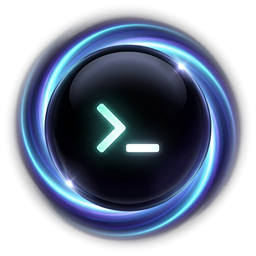

<p align="center">
  
</p>

<h1 align="center">Herdr Bubble</h1>

<p align="center">
  An AssistiveTouch-style floating desktop bubble for Windows that launches, focuses, and minimizes your terminal (<a href="https://github.com/gentleman-programming/herdr">Herdr</a> or any terminal) in a single click or hotkey.
</p>

---

## Features

- **One-click terminal toggle**: Click the bubble (or press **`Ctrl + Alt + H`**) to bring your terminal to the front or minimize it. If no terminal is running, it launches a new one and automatically pins it.
- **Multi-monitor & mixed-DPI ready**: Drag freely across primary laptops, ultrawides, and mixed-DPI setups without coordinate drift or screen clamping.
- **Free placement or magnetic edge snap**: Leave the bubble anywhere on any screen, or toggle **Magnetic edge snap** from the context menu.
- **Black-hole emergence animation**: Fast (~290 ms) singularity burst and shockwave animation on click without delaying terminal focus.
- **Status indicator dot**:
  - **Emerald**: Target terminal is open and active
  - **Sky blue**: Target terminal is minimized and ready
  - **Amber**: No matching terminal is open (click to launch)
- **Persistent settings & position**: Remembers your coordinates and preferences across restarts, validating connected monitors on startup.
- **Idle auto-dim & system tray**: Gently dims to `0.48` opacity after ~4 seconds of inactivity, includes a tray icon (`Show`, `Reset Position`, `Start with Windows`, `Exit`), and safely wakes the running instance if launched twice.

---

## Quick Start

### Option 1: Install from Source (Windows 10 / 11 + .NET 7+ SDK)

```powershell
git clone https://github.com/jdmbhere/herdr-bubble.git
cd herdr-bubble
.\install.ps1
```

`install.ps1` publishes the app to `%LOCALAPPDATA%\HerdrBubble\HerdrBubble.exe`, registers **Start with Windows** (`HKCU\Software\Microsoft\Windows\CurrentVersion\Run`), and adds a **Herdr Bubble** shortcut to your Start Menu.

### Option 2: Build Manually

```powershell
dotnet build -c Release
```

The compiled binary will be under `bin\Release\net7.0-windows\HerdrBubble.exe`.

### Uninstall

```powershell
.\uninstall.ps1
```

Pass `-KeepSettings` to preserve `%LOCALAPPDATA%\HerdrBubble\settings.json`.

---

## Configuration

Settings are automatically saved to `%LOCALAPPDATA%\HerdrBubble\settings.json`:

```json
{
  "WindowX": 2200,
  "WindowY": 420,
  "MagneticEdgeSnap": false,
  "StrictHerdrTitleFilter": false,
  "IdleDimEnabled": true,
  "LaunchCommand": "herdr",
  "TargetKeyword": "herdr"
}
```

- **`LaunchCommand`**: Command executed inside Windows Terminal (`wt.exe`) or `cmd.exe` when launching a new terminal (default: `"herdr"`). You can swap this for `"pwsh"`, `"wsl"`, or any CLI tool.
- **`TargetKeyword`**: Process name or window title keyword prioritized when detecting your primary terminal (default: `"herdr"`).
- **`StrictHerdrTitleFilter`**: When `true`, auto-selection only matches windows containing `TargetKeyword` (manual pinning via right-click still works).

---

## Controls

| Action | Behavior |
|---|---|
| **Left click** | Launch, focus, or minimize the active/pinned terminal |
| **Drag** | Move freely across any monitor |
| **Right click** | Pin a specific terminal window or toggle preferences |
| **`Ctrl + Alt + H`** | Global toggle hotkey |
| **Tray icon (left click)** | Bring bubble into view and highlight it |

---

## License

[MIT](LICENSE) © 2026 je1nsprogram
